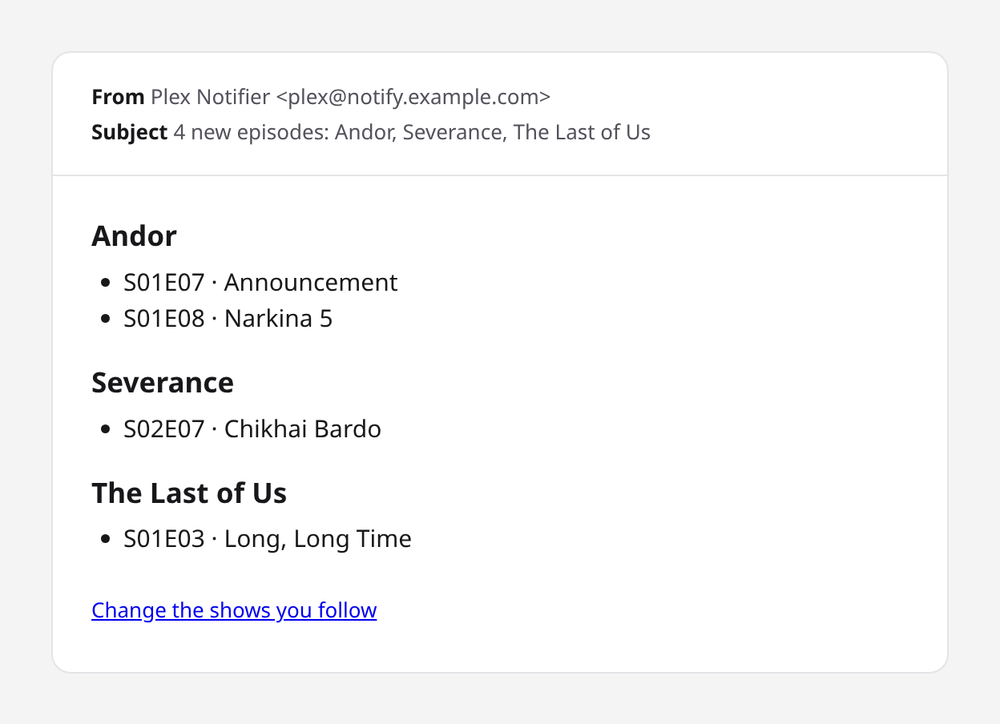
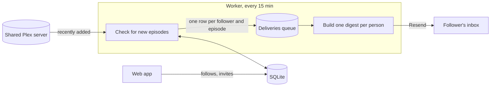

# Plex Notifier

[](https://github.com/hakonthrastar/plex-notifier/actions/workflows/ci.yml)

**Get an email when new episodes of your shows land on a Plex server someone shared with you.**

Plex tells the server's owner when something new arrives, but not the friends they share it with.
Plex Notifier watches a shared server, lets each invited person pick the shows they follow, and sends
them one tidy digest when new episodes show up.

<p align="center">
  
</p>

## Features

- **Pick your shows.** Everyone follows their own list from the server's library.
- **One digest, not a flood.** New episodes are batched into a single email per person, grouped by show.
- **Invite-only.** No passwords and no sign-up: invited people sign in with a magic link that expires
  after 15 minutes.
- **Never the same episode twice.** Episodes are identified by show, season and number, so a file
  upgraded to better quality doesn't trigger a second email.
- **No duplicate emails on retries.** A digest is marked sent only after the email provider accepts it,
  and a retry reuses the same idempotency key.
- **Quiet first run.** The first check records the existing library silently instead of announcing
  hundreds of "new" episodes.
- **Self-hosted.** One Docker image runs the web app and the background worker, with SQLite for storage.

## How it works



1. The worker fetches recently added episodes from the shared server.
2. Episodes it hasn't seen before are queued for everyone who follows that show.
3. Each person's queued episodes become one digest, sent through [Resend](https://resend.com).
   Anything that fails to send stays queued and is retried on the next run.

The rules that decide what's new and what goes in an email are pure functions with unit tests
(`src/lib/new-episodes.ts`, `src/lib/digest.ts`), kept apart from the database and network code.

## Tech stack

| | |
| --- | --- |
| App | [Next.js 16](https://nextjs.org) (App Router), React 19, TypeScript, Tailwind CSS |
| Data | SQLite via [Drizzle ORM](https://orm.drizzle.team) and libSQL, migrations applied on start |
| Auth | [Better Auth](https://better-auth.com) with invite-only magic links |
| Email | [Resend](https://resend.com) |
| Tests | [Vitest](https://vitest.dev) |
| Deploy | Docker Compose; GitHub Actions builds the image and publishes it to GHCR |

## Running it locally

You need Node 24 (`nvm use`), a Plex account with access to a shared server, and a Resend API key.

```sh
npm install
cp .env.example .env.local     # fill in PLEX_TOKEN, RESEND_API_KEY, EMAIL_FROM, BETTER_AUTH_SECRET
npm run db:migrate
npm run people:add -- "Your Name" you@example.com
npm run dev                    # http://localhost:3000
```

In development, sign-in links are also printed to the console, so you can log in without sending email.
Press **Refresh from Plex** to load the library, follow a few shows, then run `npm run check` to try a
check by hand.

| Command | What it does |
| --- | --- |
| `npm run dev` | Dev server on port 3000 |
| `npm test` | Unit tests |
| `npm run lint` / `npm run build` | Lint and production build (CI runs both) |
| `npm run check` | Run one check and send the digests |
| `npm run worker` | Run the check on a timer, like the `worker` container |
| `npm run plex:check` | Test the Plex connection |
| `npm run people:add -- "Name" email` | Invite someone |

## Deploying

The app runs as two containers, `app` and `worker`, from the same image. It serves plain HTTP and
expects a reverse proxy in front for HTTPS. [`docs/deploy.md`](docs/deploy.md) walks through the whole
setup on a Proxmox VM, from creating the VM to backups.

## About this project

I built this to practise AI-assisted development with the habits I'd expect on a professional team:
planning before building, small focused pull requests, tests written first for the decision logic,
and CI that has to pass before anything ships.
